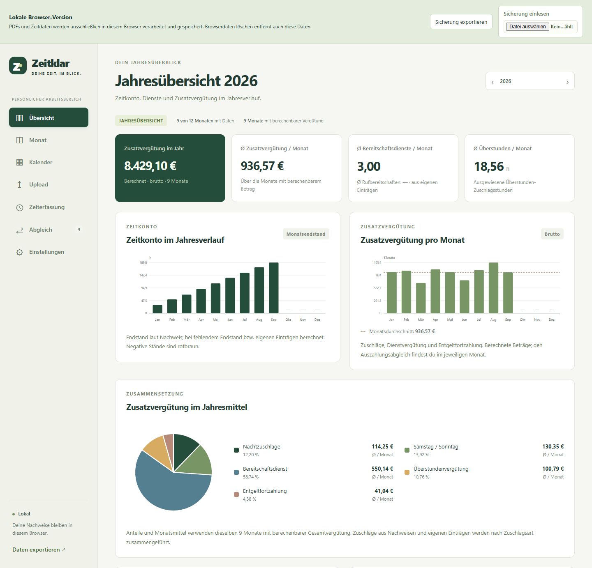
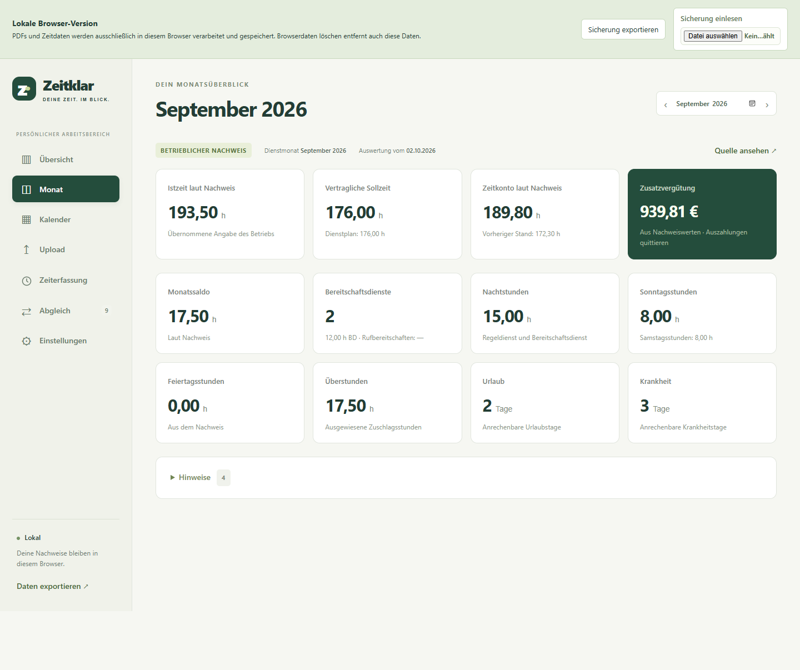
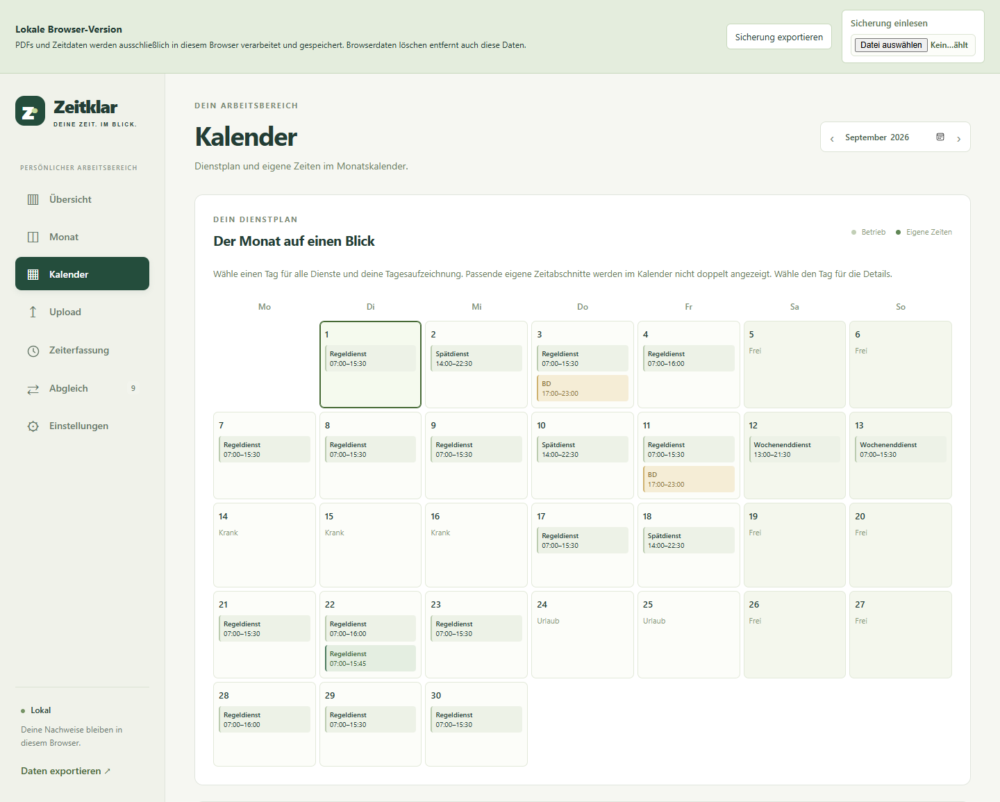
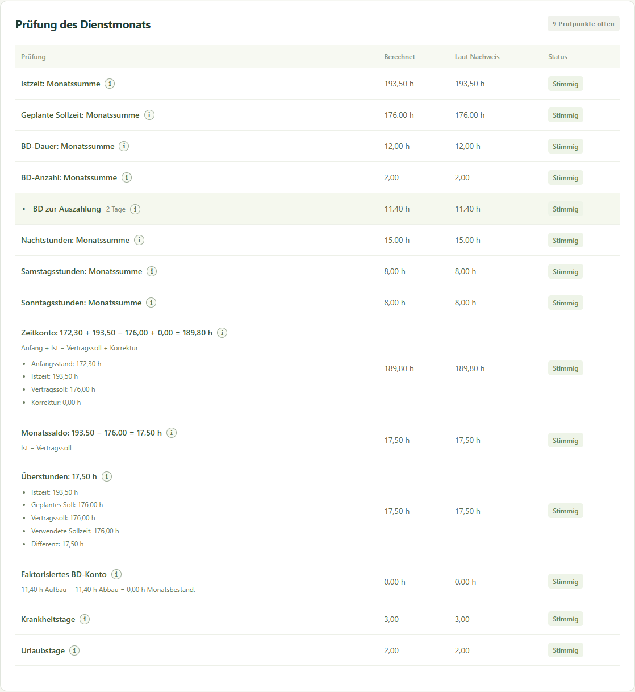
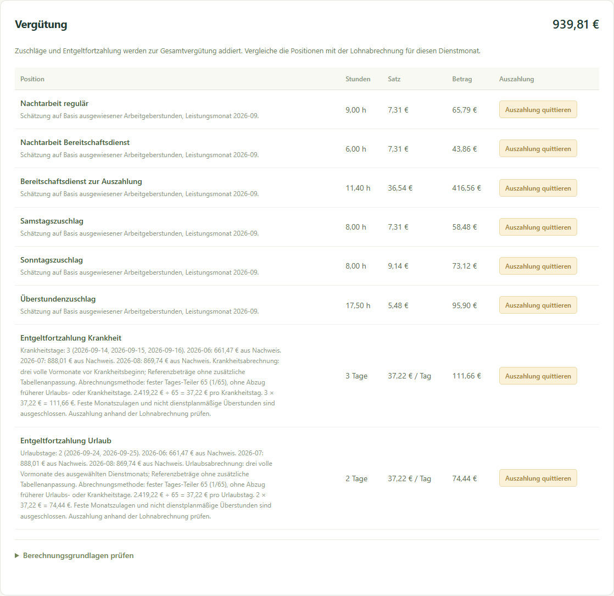

# Zeitklar

Private Webapp zur Kontrolle von Zeitnachweisen nach TV-Ärzte/TdL. 

## Stack

Svelte 5 / SvelteKit, Node.js 24, SQLite. Läuft wahlweise in Docker auf dem eigenen Server oder komplett im Browser als statisch hostbare Version – die Daten bleiben dabei lokal.
## Vorschau




<details>
<summary>Monatsübersicht: Arbeitszeit, Dienste, Urlaub und Krankheit</summary>



</details>

<details>
<summary>Kalender: Dienstplan und eigene Zeiten</summary>

Regeldienste, Spätdienste und Bereitschaftsdienste im Monatskalender; am 22. September weicht die eigene Aufzeichnung im Beispiel um 15 Minuten ab.



</details>

<details>
<summary>Stundenabgleich: Summen, Zeitkonto und Rechenwege</summary>



</details>

<details>
<summary>Vergütung: Zuschläge und Auszahlungskontrolle</summary>



</details>


Zum Ausprobieren: [fiktive Demo-Sicherung](docs/demo/zeitklar-demo.json) über „Sicherung einlesen“ im Browser importieren. Wie das geht und wie man neue Screenshots erzeugt: [docs/demo/README.md](docs/demo/README.md).

## Start mit Docker

```sh
docker compose up -d --build
```

Danach http://localhost:3000 öffnen. Die Daten liegen im Volume `zeitklar-data`; `docker compose down` erhält sie, `down -v` löscht sie.

Ohne Passwort ist die App für alle erreichbar, die Zugriff auf den Port haben – die Bindung zeigt standardmäßig nur auf `127.0.0.1`. Für einen Passwortschutz `.env.example` nach `.env` kopieren und `APP_PASSWORD` setzen (Benutzername: `zeitklar`). Für Zugriff von außen einen HTTPS-Reverse-Proxy vorschalten und `ORIGIN` auf die tatsächliche URL setzen; bei genau einem Proxy zusätzlich `ADDRESS_HEADER=X-Forwarded-For` bzw. `XFF_DEPTH`, damit der Rate-Limiter funktioniert.

Für den Image-Build im Portainer-Webeditor gibt es ein eigenes Dockerfile und Quellcodearchiv: [Portainer-Anleitung](deploy/portainer/README.md). Das normale Dockerfile braucht den vollständigen Projektordner als Build-Kontext.

## Ablauf

1. **Einstellungen** – Entgeltgruppe, Entgeltstufe, optional das Datum des nächsten Stufenaufstiegs. Das Stundenentgelt rechnet die App aus der TdL-Tabelle des Dienstmonats; die Überstunden-Grundvergütung ist auf Stufe 4 begrenzt, die Zuschlagsbasis bleibt Stufe 3. Dazu Wochenverteilung und Bundesland des Arbeitsorts. Feiertage werden pro Jahr berechnet, örtliche Sonderfälle und Zusatztage lassen sich ergänzen.
2. **Upload** – eine oder mehrere Zeitnachweislisten als PDF oder TXT. Die Dienstmonate erkennt die App selbst; ungeprüfte Nachweise bleiben in der Prüfliste, auch nach Neuladen oder weiteren Uploads.
3. **Übersicht / Kalender / Zeiterfassung** – Arbeitgeberangaben, Dienstblöcke und Auffälligkeiten nachvollziehen. Beim ersten Öffnen der Zeiterfassung sind heute (Europe/Berlin) und der aktuelle Monat vorausgewählt; ein im Kalender gewählter Tag wird übernommen. Ankunft, Feierabend und genommene Pause speichern. Eigene Aufzeichnungen werden separat gegen die Arbeitgeber-Istzeit gehalten.
4. **Abgleich** – Stundenrechnungen prüfen und die Auszahlung jeder Zuschlagsposition direkt neben ihrem Betrag quittieren. Ohne Abgleich mit der Lohnabrechnung bleibt jeder Eurobetrag eine Schätzung auf Basis der ausgewiesenen Stunden. Eine Monatsnotiz lässt sich separat speichern.
5. **Krankheit und Urlaub** – die Tageszählung läuft automatisch aus dem Nachweis, einschließlich Krankheits- und Urlaubsmarkierungen in Folgezeilen. Gezählt werden Tage mit Soll-/Istgutschrift, geplantes Frei/FZA bleibt ausgeschlossen. In der Zeiterfassung lässt sich ein Tag ausdrücklich als geplanter Arbeitstag oder Frei/FZA kennzeichnen.

### Entgeltfortzahlung

Krankheit und Urlaub werden aus den drei vollen Kalendermonaten vor dem Beginn gerechnet. Die Referenzbeträge werden ohne zusätzliche Tabellenanpassung gemittelt, deshalb landen alle Urlaubstage eines Monats in einer gemeinsamen Vergütungsposition. Als variable Zuschläge nimmt die App erkennbare Werte aus den Referenznachweisen oder eigenen Einträgen; feste Monatszulagen und nicht dienstplanmäßige Überstunden fließen nicht ein, unklar bezahlte BD-Grundvergütung und uneindeutige FT-100-%-Beträge werden mit Hinweis ausgelassen.


Krankheit während eines markierten Urlaubs zählt nur als Krankheit; unbezahlter Urlaub und Sonderurlaub werden nicht automatisch vergütet. Fehlende Referenzmonate werden benannt, Tagessatz und Gesamtvergütung bleiben dann offen. Krankengeldzuschuss sowie Netto- und Steuerberechnung macht die App nicht; Beschäftigungsbeginn, Arbeitszeitänderungen, Anspruchsdauer und besondere Vergütungsbestandteile müssen anhand der Unterlagen geprüft werden.

### Stundenprüfungen

Drei Prüfungen mit ausgeschriebenem Rechenweg direkt in der Prüftabelle:

- **Monatssaldo**: Ist − Vertragssoll.
- **Überstundenbasis**: Ist − max(Dienstplansoll, Vertragssoll). Nur eine positive Differenz ergibt Zuschlagsstunden, eine negative bedeutet 0 h.
- **Zeitkonto**: Anfangsstand + Ist + BD-FZA-Zugang − Vertragssoll + Korrektur. Der BD-FZA-Zugang zählt nur bewertete Tagesstunden ausdrücklich als `BD-St.…-FZA` markierter Dienste; bezahlte BD-Stunden und das faktorisierte BD-Konto werden nicht zusätzlich angerechnet.

Gleiche Beträge gelten als „Stimmig“, unterschiedliche als „Abweichung“, fehlt der Vergleichswert im Nachweis, bleibt „Prüfen“. Alle Annahmen stehen im Erklärungstext der Prüfzeile..

BD-Grundbewertungen erscheinen im Abgleich getrennt als Freizeitausgleich und Auszahlung mit aufklappbaren Tageswerten; der Aufbau des Auszahlungskontos wird gegen die bewerteten `bez`-Tageswerte geprüft. Für eindeutig bezahlte BD rechnet die App eine eigene Vergütungsposition aus bewerteten Stunden × individuellem Stundenentgelt, die tatsächliche Zahlung muss separat quittiert werden. Fehlende Bewertungen oder im selben Tageswert vermischte bezahlte und FZA-Dienste bleiben zur Prüfung offen.

Das **Freizeitkonto Feiertagsarbeit** rechnet separat: Endstand des Vormonats + Feiertagsstunden mit FZA − genommener FT-FZA − ausgezahlte ältere FT-Stunden. Fehlende Anfangsstände werden mit benannter Annahme vorläufig gerechnet.

Der **einmalige Zeitkonto-Anfangsstand** steht in den Einstellungen zusammen mit dem Monat, ab dem er gilt. Folgemonate übernehmen den Endstand des vorherigen Nachweises; fehlt der, den vorläufigen Stand aus den eigenen Aufzeichnungen des Vormonats (inklusive BD-FZA und Korrekturen), auch über mehrere Monate und den Jahreswechsel. Ein später bestätigter Arbeitgebernachweis hat Vorrang; bei Lücken wird die Lücke angezeigt. Zeitkontokorrekturen bleiben monatsbezogen und stehen ebenfalls in den Einstellungen.


Arbeitgebermeldungen (Ruhezeitverletzungen, Überlapp von Solldienst und BD) stehen unten im Abgleich als Information ohne Quittierungspflicht. **Opt-out** wird einmalig unter Einstellungen hinterlegt (nicht hinterlegt / keine Vereinbarung / vereinbart mit optionaler Wochenstundengrenze); aus einer Angabe im Nachweis wird keine eigene Vereinbarung abgeleitet. Opt-out und Arbeitsschutzkonto erzeugen keine monatlichen Prüfpunkte.

## Import und Datenmodell

- Eigener Parser für die DPL-Zeitnachweisliste: mehrzeilige Tage, Soll/Ist, Bereitschaftsdienst, Zuschlagsstunden, Summen, Umbuchungen, gemeldete Auswertungsfehler.
- PDF-Textextraktion erhält die Spaltenpositionen. Nur PDFs mit Textschicht; gescannte Dateien brauchen vorher OCR. Endzeiten wie `24:00` gelten als Mitternacht am Ende des Tages.
- Einfache TXT-Zeilen: `03.08.2026;08:00;17:00;30` (Pause in Minuten), `06.08.2026;Urlaub`, `07.08.2026;Krank`. Beispiel unter `/beispiel.txt`.
- Nachweise werden als versionierte Quellen gespeichert. Identische Nachweise werden nicht doppelt angelegt; bei neuen Fassungen zeigt die App die letzte des Monats, ältere bleiben im Datenexport.
- Die Originaldatei wird nach der Extraktion nicht archiviert; extrahierter Text, Quellenname und strukturierte Werte bleiben in SQLite.
- Einstellungen können ab einem Monat eine neue Fassung bekommen (**Einstellungen → Fassung der Einstellungen**): Die neue Fassung übernimmt zunächst alle Werte, Änderungen wirken nur ab diesem Monat, frühere Monate bleiben unverändert. Fassungen lassen sich zusammenführen; ohne Fassung gilt ein Profil für alle Monate. Anfangsstand, Dienstvorlagen und Profilbestätigung gelten immer für alle Monate.
- Ein Stufenaufstieg gilt für den gesamten Vorrückungsmonat (§ 17 Abs. 1 TV-Ärzte). Aus der ausgewählten Stufe und dem Aufstiegsdatum rekonstruiert die App frühere und spätere Stufen mit den regulären Laufzeiten – das setzt durchgehende Laufzeiten innerhalb der Entgeltgruppe voraus; Gruppenwechsel und Unterbrechungen müssen anhand der Personalmitteilung berücksichtigt werden. Ohne Aufstiegsdatum bleibt die Stufe konstant.
- Einstellungen speichern nach kurzer Eingabepause automatisch; ungültige Eingaben bleiben zur Korrektur stehen.
- Arbeitszeitänderung: standardmäßig 42 Wochenstunden vor dem 1. Januar 2026, danach 40. Die Wochenverteilung beschreibt die Zeit danach, frühere Sollstunden werden proportional angepasst. Ohne Aktivierung bleibt die bestehende Sollverteilung.
- Alte Sicherungen mit manuell eingetragenen Stundenentgelten bleiben im manuellen Modus; Umstellung über „Stundenentgelte → Aus Entgelttabelle“. Manuelle Sätze ändern sich bei einem Stufenaufstieg nicht automatisch.

## Berechnungsumfang und Grenzen

Implementiert: Stundenabgleich, Trennung von Kontosaldo und Überstunden, Nacht-/Samstags-/Sonntags-/Feiertagszuschläge, Grundbewertung von Bereitschaftsdienst und Rufbereitschaft, manuelle Ergänzungen für Dienstplanbesonderheiten. Zuschläge sind Bruttowerte. Die Normenzusammenstellung liegt in `docs/tarifgrundlage.md`.

Nicht automatisiert: Pausenunterstellung (Pausen gelten nicht als genommen), tarifliche Überstunden aus einer Monatsdifferenz (dafür braucht es Dienstplan, Anordnung und Ausgleichsfristen), Landesregelungen, Nebenabreden, Teilzeit-Sonderfälle, halbe Dienste, Quartalsausnahmen, Abgaben/Netto, Ausschlussfristen, die vollständige ArbZG-Prüfung. BD-Zusatzpunkte und dienstplanabhängige Zuschläge werden manuell eingegeben; es gibt kein Urteil über die Rechtmäßigkeit eines Dienstplans. Bei eigenen Einträgen ohne genaue Pausenlage sind Zuschlagszeiten nur proportional geschätzt.

Zeitintervalle laufen als lokale Uhrzeiten – Dienste über die Sommer-/Winterzeitumstellung gesondert prüfen. Originalnachweise und Lohnabrechnungen aufbewahren.

Tarifgrundlagen: [TV-Ärzte beim TdL](https://www.tdl-online.de/tarifvertraege/tv-aerzte) (Fassung vom 9. Juni 2026), Stufentabellen aus [Anlage A (April 2026–August 2027)](https://www.tdl-online.de/fileadmin/downloads/TV-Aerzte/01_TV-Aerzte/Anlage_A_zum_TV_%C3%84rzte_v._01.04.2026_bis_31.08.2027.pdf) und [Anlage B (ab September 2027)](https://www.tdl-online.de/fileadmin/downloads/TV-Aerzte/01_TV-Aerzte/Anlage_B_zum_TV_%C3%84rzte_ab_01.09.2027.pdf). Stundenentgelt bei 40 Wochenstunden: Monatsbetrag / (4,348 × 40), auf Cent gerundet (§ 24 Abs. 3 und 4) – der angezeigte Monatsbetrag ist Vollzeit, nicht die Teilzeit-Auszahlung. Historische Tabellen ab Oktober 2023 stammen aus dem [Änderungstarifvertrag Nr. 9](https://www.marburger-bund.de/sites/default/files/tarifvertraege/2024-11/TdL%20TV-%C3%84rzte%20i.d.F.%209.%C3%84nderungsTV.pdf); Ä 3 / Stufe 4 ist erst ab Januar 2026 verfügbar, davor werden keine Tabellenbeträge behauptet. Der historische Stundenteiler rechnet mit 42 Wochenstunden bis Dezember 2025 und 40 ab Januar 2026 ([TdL-Mitteilung zum Abschluss](https://www.tdl-online.de/presse/detail/tarifeinigung-fuer-aerztinnen-und-aerzte)); bei aktivierter Arbeitszeitänderung richtet er sich nach den eingestellten Vollzeitwerten.

Feiertage gibt es für alle 16 Bundesländer. Mariä Himmelfahrt (Bayern), das Augsburger Friedensfest und örtliches Fronleichnam (Sachsen/Thüringen) sind eigene Optionen, weil der konkrete Arbeitsort entscheidet: [Bayerisches Feiertagsgesetz](https://www.gesetze-bayern.de/Content/Document/BayFTG/true), [Sächsisches Sonn- und Feiertagsgesetz](https://www.revosax.sachsen.de/vorschrift/3997). Die Regeln liegen lokal und müssen bei Gesetzesänderungen angepasst werden. Zur Laufzeit ruft die App keine Tarifdaten im Internet ab.

## Entwicklung

Hinweise zu Prüfungen und Repository-Inhalten: [CONTRIBUTING.md](CONTRIBUTING.md).

```sh
npm ci
npm run dev      # http://127.0.0.1:5173
npm run check
npm test
npm run build
```

Node.js 24, SQLite über `node:sqlite` – ein experimentelles Built-in, das die App isoliert in `src/lib/server/sqlite.ts` lädt (`engines.node >= 24`). Beim Node-Upgrade die Persistenz testen: `npm test`, dann einen Nachweis importieren und neu laden.

**Aufbau:** Die Fachlogik liegt framework-frei in `src/lib`. `workspace.ts` beschreibt den gespeicherten Arbeitsbereich mit allen Operationen und Schema-Migrationen, `actions.ts` enthält jede Formularaktion genau einmal. Server (`server/db.ts`) und Browser-Version (`browser/store.ts`, IndexedDB) sind reine Speicheradapter; `tests/storage-parity.test.ts` prüft, dass beide aus denselben Aktionen dasselbe Ergebnis erzeugen. Die Oberfläche besteht aus `src/routes/+page.svelte` und einer Komponente je Tab in `src/lib/components/tabs/`. `npm run format` formatiert mit Prettier, die CI prüft das Format.

`DATA_DIR` setzt ein anderes Datenverzeichnis. Uploadgrenzen: 20 Dateien, 10 MB pro Datei, 100 MB insgesamt; Requestgrenze im Container 110 MB, ein vorgeschalteter Proxy muss das mittragen.

Die Startansicht **Übersicht** zeigt das Jahr: Balkendiagramme für Zeitkonto-Endstände, Zusatzvergütung, Bereitschaftsdienste und Überstunden-Zuschlagsstunden, dazu ein Kuchendiagramm der Vergütungsbestandteile im Monatsmittel. **Monat** zeigt Monatskennzahlen, **Abgleich** Prüfergebnis und Auszahlungsabgleich. Ein Klick auf einen Balken oder eine Monatszeile öffnet den Monat. Die Jahresauswertung nimmt pro Monat den neuesten bestätigten Nachweis, ersatzweise eigene Einträge, mit denselben Grundlagen wie die Monatsansicht. Fehlende Werte erscheinen als Lücken; Durchschnitte nutzen nur Monate mit bekannten Werten. Zeitzuschläge aus eigenen Einträgen werden nach Nacht, Wochenende und Feiertag aufgeteilt (inklusive Zuschlagskonkurrenz und Pausen) und mit den Zuschlagsarten aus Nachweisen zusammengeführt. Rufbereitschaftszahlen kommen nur aus eigenen Einträgen, weil Nachweise dafür keine verlässliche Monatssumme enthalten.

Zeiterfassung und Kalender nutzen dasselbe Formular: konfigurierte Dienste, manuelle Zeitblöcke, Urlaub, Krankheit, **Frei nach Dienst (FnD)** und **Freizeitausgleich (FzA)**. FnD und FzA behalten die Sollstunden des Wochenprofils, bekommen aber keine Arbeitszeit- oder Abwesenheitsgutschrift; zusammen mit den morgendlichen Zeitabschnitten eines am Vortag begonnenen Nachtdiensts lassen sie sich speichern. Bereitschaftsstufe und BD-Ausgleich stehen in der Dienstkonfiguration, Zusatzpunkte und Dienstplanzuschlag im Erfassungsformular. Dienste aus einer Vorlage übernehmen deren aktuelle Werte auch für bereits erfasste Monate; ältere manuelle BD-Einträge ohne Zuordnung ergänzen fehlende Angaben aus genau einer passenden Vorlage, ausdrückliche manuelle Angaben haben Vorrang. BD-FZA erhöht das Zeitkonto um BD-Stunden × Stufenfaktor (inklusive bestätigter Zusatzpunkte und Feiertagsbewertung), ausgezahlte BD erhöht die Vergütung. Feiertags-FZA lässt sich in den Einstellungen festlegen; Angaben einzelner Einträge bleiben maßgeblich. Bei konfigurierten Diensten wird eine eingegebene Pause proportional auf die Zeitabschnitte verteilt.

## Gehostete App mit lokaler Verarbeitung

```sh
npm run build:browser
npm run preview:browser   # http://127.0.0.1:5175
```

Die statische Version nutzt dieselbe Oberfläche, denselben DPL-Parser und dieselbe Tarifberechnung. Alles läuft im Browser, die Daten liegen in IndexedDB; es gibt keine Upload-API und keine extern geladenen Schriftarten, der PDF-Worker gehört zum Build. Zum Hosting den gesamten Inhalt von `dist-browser/` auf einen statischen HTTPS-Host legen – kein Node-Server, keine Datenbank. Relative Asset-Pfade und Unterverzeichnisse funktionieren; `index.html` enthält eine Content Security Policy, die fremde Quellen und Formularübertragungen blockiert. Zum Entwickeln: `npm run dev:browser`, Typprüfung: `npm run check:browser`.

Der Host sieht normale Abrufe der App-Dateien, aber keine Zeitnachweise oder Eingaben. Er liefert allerdings den ausführbaren Code aus – die Zusicherung gilt für einen vertrauenswürdigen, unveränderten Build.

Browserdaten hängen an Browserprofil und Domain; ein anderer Browser oder ein anderes Gerät hat einen eigenen Datenbestand. **Browserdaten löschen entfernt die Aufzeichnungen** – regelmäßig „Sicherung exportieren“. „Sicherung einlesen“ versteht auch den JSON-Export der Docker-Version, fügt neue Einträge hinzu und behält vorhandene Monatsabgleiche; Konflikte werden gemeldet, der Import ist atomar. Ein eingerichtetes Browserprofil wird dabei nicht überschrieben.

## Sicherung

Über **Datenexport** werden Einstellungen, Einträge, Monatsabgleiche, Quittierungen, ungeprüfte Uploads und alle Nachweisversionen als JSON heruntergeladen. Beide Versionen können den Export über „Sicherung einlesen“ übernehmen (Docker: in der Seitenleiste unter „Daten exportieren“) – so lassen sich Daten auch zwischen Browser- und Docker-Version umziehen.

Für eine vollständige wiederherstellbare Sicherung den Container stoppen und das Docker-Volume sichern; beim Wiederherstellen das gesamte Datenverzeichnis mit passenden Rechten für Benutzer `node` zurückspielen. SQLite-Dateien inklusive `-wal`/`-shm` gehören zusammen – keine laufende Datenbankdatei isoliert kopieren.

## Lizenz

Zeitklar steht unter der [MIT-Lizenz](LICENSE). Verwendete Drittanbieter-Komponenten behalten ihre jeweiligen Lizenzen.
